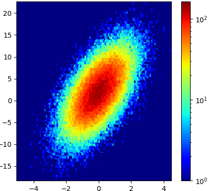

# Data Analytics (CS301)

Fall 2026

## Course Final Project: An Original Data Science Study

Please read this whole document carefully. It describes what you will do, what
you will submit, and how your work will be graded.

## Due Dates

**Note:** Deadlines are strict. No extensions will be granted, and **no late
projects can be accepted after the due date.**

- **Assigned:** Monday, 23 November 2026
- **Progress update presentations:** Thursday, 3 December 2026, during lab
- **Project due:** Wednesday, 9 December 2026, by 9am.
  - The project due dates is a hard deadlines.

Note: We are following the exam period code "G" from the college's exam planning schedule.

<center>
&#x200B;

</center>

*Figure 1:* In its raw text form, data is hard to read. When we use color and
shape to represent the numbers, the patterns and trends behind them become
visible, and we can draw meaningful conclusions.

## Overview

Get ready to dig deep into Data Science! In this project you will carry out a small piece of **original research**, the way a professional data scientist would. You will:

1. ask a focused **research question** about a topic that interests you,
2. turn it into testable **hypotheses**,
3. find **free, public data** that can answer it,
4. use **plots** to look for patterns that are not just random noise,
5. **choose and justify** at least two statistical models,
6. write **R code** that runs your analysis from top to bottom without errors,
7. report your **results** honestly, and
8. draw **conclusions** that answer your question and admit their limits.

You will write up your work in a **Quarto report**
(`writing/report.qmd`), which combines your writing, code, plots and results in
one document. The template contains a `TODO` everywhere you need to add
something.

**Expected effort:** about the same as three lab assignments (roughly three to
five hours of focused work). Start early. Finding good data usually takes
longer than people expect. If you are looking for data, there are many places 
online that might be able to help. Check out the below collections of database sources.

- Your instructor's website.
  - <a href="https://www.oliverbonhamcarter.com/resources/consolidated_resources/#general-data-repositories" target="_blank">https://www.oliverbonhamcarter.com/resources/consolidated_resources/#general-data-repositories</a>

- "Awesome Public Datasets"
  - <a href="https://github.com/awesomedata/awesome-public-datasets" target="_blank">https://github.com/awesomedata/awesome-public-datasets</a>


## Learning Objectives

By completing this project, you will be able to:

- develop a research question that can be answered with data;
- state null and alternative hypotheses and test them;
- judge whether a public dataset is credible and suitable;
- use visualization techniques to find patterns and tell whether they look non-random;
- choose statistical models that match your data and support your research questions. You will be able to determine outcomes and verify assumptions;
- write reproducible R code and a Quarto report;
- communicate your results, address limitations and ethical issues clearly.

## Working Individually or in Pairs

You may work alone or in a pair (maximum **two** people). Pairs are expected to do more:

| Requirement | Individual | Pair |
|---|---|---|
| Research question | 1 | 1 |
| Hypothesis pairs (H0 / H1) | at least 2 | at least 3 |
| Statistical models or tests | at least 2 different | at least 3 different |
| Exploratory plots | at least 4 (at least 1 interactive) | at least 6 (at least 1 interactive) |
| Shuffle comparison plot | at least 1 | at least 1 |
| Robustness check | not required | required |
| Peer-reviewed sources | at least 2 | at least 2 |

Pairs submit one repository, one report and one reflection. Both partners must
commit to the repository regularly. If the commit log shows that one partner
did much less work, that partner's grade will be reduced.


## The Research Process: What Each Part Requires

Each step below matches a section of `writing/report.qmd`.

### 1. Research question development

Choose an application area that interests you (health, environment, sports,
education, economics, transportation, music, ...). Read a little about it,
then write **one** focused research question.

A good research question is:

- **specific:** it names the population, variables and time span;
- **measurable:** your data contains variables that measure its key ideas;
- **answerable:** statistics on your data can answer it; and
- **manageable:** you can finish it in the time available.

| Too broad | Better |
|---|---|
| "What affects health?" | "In U.S. counties in 2022, is the adult obesity rate associated with the number of fast-food restaurants per capita?" |
| "Is climate change real?" | "Has the average annual number of days above 90°F increased in Pittsburgh between 1950 and 2024?" |

Support your question with **at least two peer-reviewed sources** (find them
with [Google Scholar](https://scholar.google.com)). Add them to
`writing/references.bib` and cite them in your report. Blogs and news articles
do not count toward this minimum.

### 2. Hypothesis formulation

For each hypothesis, write a **null hypothesis (H0)** of "no effect / no
difference / no relationship" and an **alternative hypothesis (H1)** that
states the effect you expect. Each hypothesis must name the variables involved
and the model or test you plan to use. Use α = 0.05 unless you justify
another level.

> *Example.* H0: The mean commute time is the same for workers who drive and
> workers who take public transit. H1: The mean commute time differs between
> the two groups. (Welch two-sample t-test, `commute_minutes ~ mode`.)

### 3. Data selection

- Use only data that is **free and publicly available**. Do not buy data or
  use private data.
- Choose a **credible source** and be able to explain who collected the data,
  how, and why.
- The dataset should be large enough to test your hypotheses (as a rough
  guide, at least a few hundred rows).
- Use a dataset you have **not** used for another project.
- Document your data in the report and in `data/README.md` (source, URL, date
  accessed, license, unit of observation, variables used).

Places to look:

- the course [resources page](https://www.oliverbonhamcarter.com/resources/dataanalytics_resources/)
- [Data.gov](https://data.gov) (U.S. government open data)
- [UCI Machine Learning Repository](https://archive.ics.uci.edu)
- [TidyTuesday](https://github.com/rfordatascience/tidytuesday) (cleaned weekly datasets)
- [Our World in Data](https://ourworldindata.org) and [World Bank Open Data](https://data.worldbank.org)
- [CDC Open Data](https://data.cdc.gov), [U.S. Census Bureau](https://www.census.gov/data.html), [Bureau of Labor Statistics](https://www.bls.gov/data/)
- [Kaggle Datasets](https://www.kaggle.com/datasets) (free; check the original source and license)

### 4. Plots that show non-random patterns

Before running formal tests, explore your data visually. Your plots should
show a pattern worth testing, such as a difference between groups, a trend
over time, or a relationship between two variables. **If you do not see any
pattern, change your question or variables now, before building models.**
Seeing a pattern early is a good sign that your project will work.

Requirements:

- the number of plots in the table above, using at least two different
  kinds of plot;
- at least one interactive plot made with `plotly`;
- a caption, labeled axes (with units) and a short interpretation for every
  plot; and
- at least one **shuffle comparison**: plot your real data next to copies in
  which the outcome has been randomly shuffled. If the real panel stands out,
  the pattern is unlikely to be random noise. The template includes a worked
  example.

### 5. Model selection and justification

Use at least **two** different statistical models or tests (three for pairs).
For each model, explain why it fits your question and your variable types,
list its assumptions, and show how you checked them. This guide may help:

| Outcome variable | Predictor(s) | Possible models / tests |
|---|---|---|
| Numeric | One categorical predictor with 2 groups | t-test (Welch), Wilcoxon rank-sum |
| Numeric | One categorical predictor with 3+ groups | one-way ANOVA, Kruskal-Wallis |
| Numeric | Two or more categorical predictors | two-way / factorial ANOVA |
| Several numeric outcomes | Categorical predictor(s) | MANOVA |
| Numeric | Numeric (and categorical) predictors | correlation test, linear / multiple regression |
| Categorical (2 levels) | Any | logistic regression, decision tree, random forest |
| Categorical | Categorical | chi-square test of independence |
| Numeric or categorical (prediction) | Many predictors | decision tree, random forest, neural network |

**Using a method not covered in class?** You are welcome to. If you do, add a
section to your report that explains in your own words how the method works,
what its output means, what it assumes, and why it suits your data better than
the methods from class. Cite at least one source for it.

### 6. Coding in R

- Use `src/analysis.r` as your "lab bench" to develop and test your code.
  Your final code, plots and results must also appear in `writing/report.qmd`.
- Load data with **relative paths** from the `data/` folder. Do not use
  `file.choose()`, `View()` or absolute paths such as `C:/Users/...`.
- Add every package you use to the `required_packages` vector at the top of
  both files.
- Use `set.seed()` before anything random (shuffling, train/test splits,
  random forests, neural networks).
- Comment your code so that a classmate could follow your reasoning.
- **Your script and your report must run from top to bottom without errors.**
  Before submitting, restart R and run:

  ```bash
  Rscript src/analysis.r
  quarto render writing/report.qmd
  ```

  GitHub Actions runs both commands every time you push (see below).

### 7. Results

For each hypothesis, report the test statistic, p-value, a confidence interval
(or another measure of uncertainty), an effect size or performance metric, and
your decision (reject or fail to reject H0). Then explain the result in plain
language. For predictive models, report performance on held-out test data,
not on the data you trained on.

### 8. Conclusions

Answer your research question directly, connect your findings to the
literature you cited, discuss limitations (sample, bias, assumptions,
correlation versus causation), and suggest future work.


## Progress Update Presentation

On **Thursday, 3 December 2026, during lab**, each individual or pair gives a
short progress update presentation (about **5 to 7 minutes**, plus a few
minutes for questions). Your project does not need to be finished yet. The
goal is to share where you are and to get feedback while there is still time
to use it.

Your presentation should cover:

1. your research question, and why it matters (with your peer-reviewed sources);
2. your hypotheses (H0 / H1) and the models or tests you plan to use;
3. your dataset: source, size, and the variables you use;
4. at least two exploratory plots, including your shuffle comparison, and what
   they suggest;
5. any preliminary results; and
6. what remains to be done, and any problems you would like advice on.

Use slides, or show your rendered `report.html` directly. If you work as a
pair, both partners must present. You must be present to receive credit.


## Repository Contents and Deliverables

There are a lot of files in this project that you should know about.

```
.
├── README.md                  # this assignment
├── config/gatorgrade.yml      # automated checks
├── data/
│   └── README.md              # TODO: fill in data provenance; add your data files here
├── src/
│   └── analysis.r             # TODO: your analysis script
└── writing/
    ├── report.qmd             # TODO: your research report (main graded document)
    ├── report.html            # the rendered report (you must commit this)
    ├── references.bib         # TODO: add your sources in BibTeX format
    └── reflection.md          # TODO: answer the reflection questions
```

You must submit the following through your GitHub repository:

1. **`writing/report.qmd`** and its rendered **`writing/report.html`**: your
   complete research report. This is the main graded document. Delete every
   `EXAMPLE` block and replace every `TODO`.
2. **`writing/references.bib`**: BibTeX entries for every source you cite.
3. **`src/analysis.r`**: your analysis script, which runs without errors.
4. **`writing/reflection.md`**: your answers to the conceptual reflection
   questions.
5. **`data/`**: your data files (or a subset of about 3 MB if the full data is
   larger than 5 MB) and a completed `data/README.md`.
6. **A commit history** that shows steady progress (at least 10 commits).

You will also give a **progress update presentation** in lab on 3 December
(see above).

Put your name(s) on every deliverable. If no names are provided, the
instructor cannot assign credit.


## Getting Started

1. Install [R](https://cran.r-project.org), [RStudio](https://posit.co/download/rstudio-desktop/)
   and [Quarto](https://quarto.org/docs/get-started/) (RStudio already includes
   Quarto) which could be helpful! Note: we have had an activity about using Quarto. If you need extra help with this software, please refer to that previous work.
2. Open `writing/report.qmd` in RStudio and click **Render**. The template
   should render before you change anything. Read the `EXAMPLE` blocks to see
   what a finished section looks like.
3. Pick a topic and dataset, then write your research question and hypotheses.
4. Work through the report section by section, committing as you go.

### Suggested timeline

So that you do not get behind, your instructor offers a timeline that might be helpful to plan this project.

| When | Milestone |
|---|---|
| By 25 November | Topic chosen, two peer-reviewed sources found, dataset downloaded into `data/` |
| By 1 December | Research question, hypotheses, data section and first exploratory plots done |
| 3 December (lab) | Progress update presentation; note the feedback you receive |
| By 7 December | Models fit, assumptions checked, results written, feedback addressed |
| By 9 December (Exam Code "G") | Conclusions, reflection, final render, all GatorGrade checks passing |


## Grading

This project will have the follow elements to consider for grading.

| Component | Weight | What we look for |
|---|---|---|
| Research question and literature | 10% | Focused, researchable question; at least two relevant peer-reviewed sources, cited correctly |
| Hypotheses | 5% | Clear, testable H0 / H1 pairs that name variables and tests |
| Data selection and wrangling | 10% | Free, public, credible data; complete provenance; cleaning steps justified |
| Exploratory plots | 10% | Required number and variety; captions, labels and interpretations; shuffle comparison |
| Model selection and justification | 15% | Models match the question and data types; assumptions stated and checked; any new method explained |
| Code and reproducibility | 15% | Script and report run without errors; relative paths; readable, commented code |
| Results | 10% | Correct statistics, uncertainty, effect sizes and decisions, explained in plain language |
| Conclusions and limitations | 5% | Research question answered; limitations and future work discussed honestly |
| Reflection | 5% | Thoughtful, specific answers to every reflection question |
| GitHub Actions build and commit history | 5% | Passing build on the last commit before the deadline; steady commits from every member |
| Progress update presentation | 10% | Present on 3rd December at lab time and cover every item listed; both partners take part |

Writing quality (clarity, spelling, grammar) counts in every component.


## GatorGrade and GitHub Actions

Every push to GitHub starts an automatic build that:

1. runs **GatorGrade**, which checks that every `TODO`, `EXAMPLE` and name
   placeholder is gone, the reflection is long enough, `references.bib` has
   enough entries, `report.html` is committed, and you have enough commits;
2. runs `src/analysis.r`; and
3. renders `writing/report.qmd`.

A red X means at least one step failed. Click it to see which step failed and
why. The X turns into a green check mark when everything passes. If your
project uses an R package that the build does not install, add it to the
"Install R packages" step in `.github/workflows/build.yml` as
`any::packagename`.

To run GatorGrade on your own computer, first make sure Python 3 is installed
(`python --version`):

- [Installing Python on Windows](https://realpython.com/lessons/python-windows-setup/)
- [How to Install Python 3](https://realpython.com/installing-python/)

Then install and run GatorGrade:

```bash
pipx install gatorgrade
gatorgrade --config config/gatorgrade.yml
```


## Submitting Your Work

Commit and push early and often:

```bash
git add -A
git commit -m "add a meaningful commit message"
git push
```

## Seeking Assistance

If you have questions, post them in the course Discord channel or come to the
instructor's or TL's office hours.

Further resources:

- [Quarto: Computations with R](https://quarto.org/docs/computations/r.html)
- [Quarto: Citations](https://quarto.org/docs/authoring/citations.html)
- [Markdown Tidbits](https://www.youtube.com/watch?v=cdJEUAy5IyA)
- [Markdown Cheatsheet](https://github.com/adam-p/markdown-here/wiki/Markdown-Cheatsheet)
